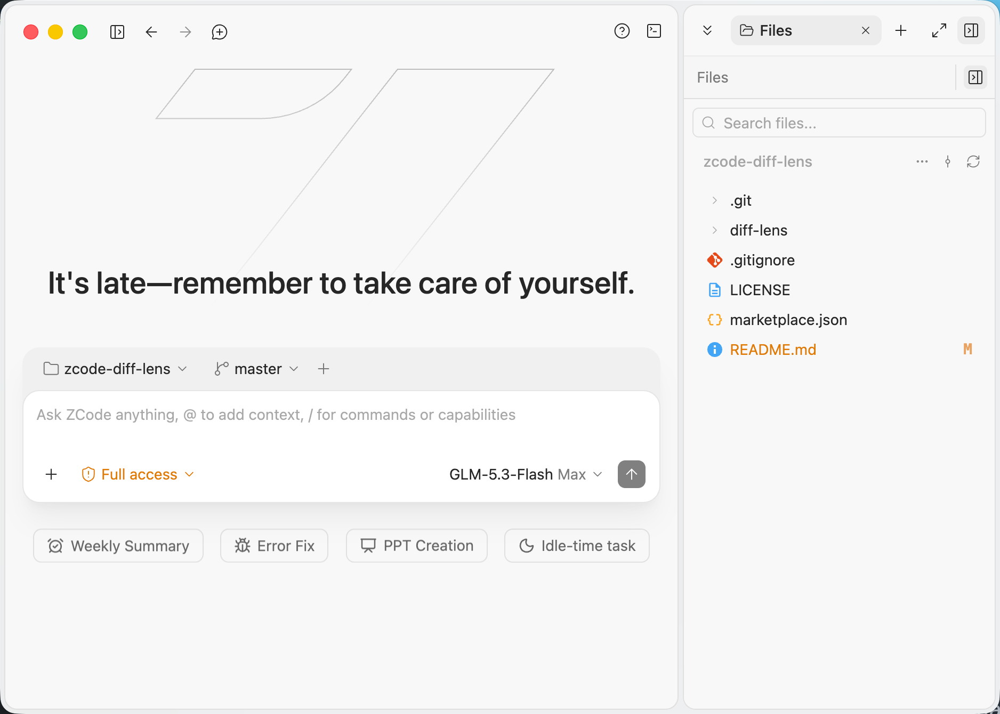

# zcode-diff-lens

**diff-lens** — a ZCode plugin: Cursor-style git change review in a session side panel,
with a cascading status tree (per-folder badges), inline Monaco diff (single- or dual-pane),
per-file revert, and one-click hand-off to the agent.

Verified against **ZCode 3.16.2**.



## Repository layout

```
marketplace.json     local dev marketplace (points to ./diff-lens)
diff-lens/           the plugin (PR-ready for zai-org/zcode-plugins/external_plugins/)
```

All documentation — features, panel symbols, architecture, security notes, development and
install steps — lives in [diff-lens/README.md](./diff-lens/README.md).

## Install from GitHub

Open **Plugin Marketplace → Add → Add Plugin Marketplace**, paste one of the sources below,
then **Personal → marketplace "diff-lens" → plugin "Diff Lens" → Install**:

- HTTPS: `https://github.com/hzbd/zcode-diff-lens`
- SSH: `git@github.com:hzbd/zcode-diff-lens.git` — usually faster over international links,
  but requires GitHub access configured first (an SSH key added to your GitHub account)

## License

[MIT](./LICENSE)
